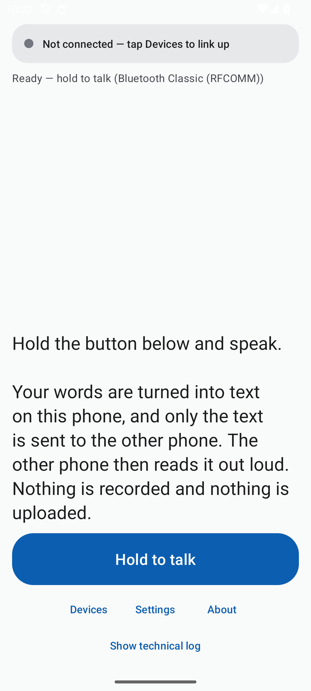
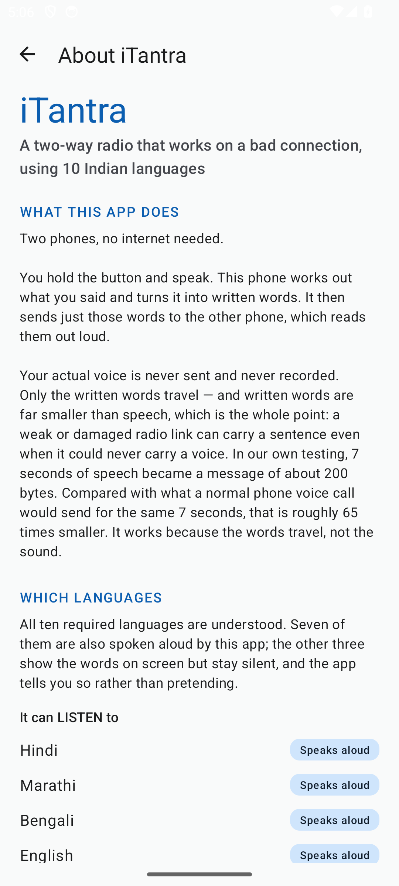
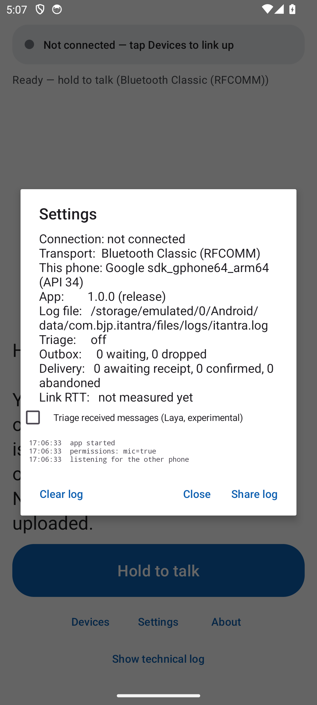
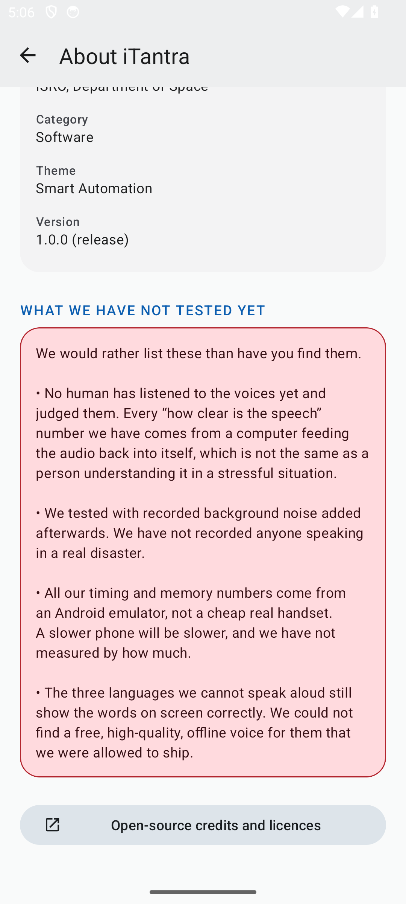

# iTantra — an offline speech radio for 10 Indian languages

**SIH26173 — Indian Multilingual TTS & STT Aided Neural Transceiver Radio Access for low bitrate links.**
SIH 2026 · Organisation **ISRO, Department of Space** · Category **Software** · Theme **Smart Automation** · Team **B.J.P — Bug Janta Party**


---

## What this is

Voice is too data-heavy for a low-bitrate link, but in a distress scenario people still need
voice — it reaches everyone, literate or not. So this app does the voice part **on the phone**:
speech recognition runs offline, the recognised **text** (a few hundred bytes) goes over
Bluetooth or Wi-Fi Direct, and the other phone speaks it out loud. Two phones behave like a
push-to-talk walkie-talkie — one that never needs a network.

**Nothing leaves the devices. No cloud, no accounts — the app does not even request the
`INTERNET` permission.**

- **Listens in 10 languages** — Hindi, Marathi, Bengali, Gujarati, Kannada, Malayalam, Odia,
  Tamil, Telugu, English. One 349 MB int8 model with its output vocabulary pruned to the
  scripts these languages need, so it *cannot* emit Arabic, CJK or Hangul noise.
- **Speaks 7 of them aloud** — Hindi, Marathi, Bengali, Tamil, Telugu, Malayalam, English. The
  other three show correct text and say so on screen; no permissively-licensed offline voice
  exists for them yet.
- **Built for a bad link** — receipts, ordered resends, reconnects, alert escalation. That is
  most of the engineering, and it is below.

## Screens

<p align="center">
  
  
  
</p>

<p align="center"><em>Release build v1.0.0 on Android 34. More screenshots in <a href="app/evidence/ui/">app/evidence/ui/</a>.</em></p>

## The link will drop. The message must not.

The problem statement is not "make a voice call" — it is "make a call that survives a bad
radio". Every item below began as a logged failure and has a finding entry with evidence in
[`docs/DELIVERY_FINDINGS.md`](docs/DELIVERY_FINDINGS.md):

- **Only text travels.** 7 seconds of speech become ~200 bytes — around 65× smaller than a
  voice call carrying the same 7 seconds.
- **The link is babysat.** 4-second heartbeats; a peer is declared gone at 12 seconds; both
  sides re-dial on their own, including after Bluetooth is toggled off and back on.
- **Every segment is ACKed, or resent.** The outbox resends on a 3/6/12 s → 15 s backoff (max
  10 tries) until the other phone acknowledges — order preserved, duplicates suppressed by a
  persistent ledger. An emergency alert jumps to the head of the queue.
- **Receipts are proof, not vibes.** The listener ACKs *before* it plays; the sender's banner
  shows "✓ Delivered" only once the words are provably on the other phone.
- **Speech arrives whole and in order.** A long hold queues every segment; an alert that
  arrives mid-speech yields and plays first; a message already heard cannot replay after a
  restart.
- **A process kill is survivable.** Pending work (outbox, receipts, ledger) is written through
  a temp-file + rename store and restored on launch. One documented gap stays honest: a kill
  between "delivered" and "spoken" loses the unspoken tail — it is logged, never silent.
- **Memory is given back, never mid-work.** Low memory releases the idle voice (~60 MB) or the
  ASR model (~340 MB) only when nothing is recording, decoding, or playing.
- **It minds the room.** Audio focus ducks other audio instead of fighting it; escalations
  buzz; none of this machinery sits on the thread that plays the message.
- **Optional triage** (Laya, experimental, off by default) flags destructive-language
  messages, so they arrive as buzzing alerts that jump the queue.

## Current status

*Last device passes: 27 Sep 2026 — the two-phone loop on two physical phones, on the earlier
build; 16 Oct 2026 — release APK v1.0.0 on an Android 34 emulator (arm64), every screen and
self-test. Next step: re-run the two-phone checklist on v1.0.0 (`docs/DELIVERY_FINDINGS.md`).*

### Proven

| Thing | Evidence |
|---|---|
| App builds, installs, runs | **Signed release APK v1.0.0** (993 MB, sha256 `0b46aeff…`), sideloadable. Launched and stayed up on Android 34 — every screen exercised, three on-device self-tests passed, zero crashes; signature, alignment and badging verified (`docs/RELEASE.md`; screenshots `app/evidence/ui/`) |
| **Two-phone loop** | 27 Sep 2026: two physical phones, no internet — speech recognised on one, sent as text over Bluetooth RFCOMM, spoken aloud on the other. Recorded in `app/VERIFICATION_STATUS.md`; the About screen states it |
| Model runs on Android | Loaded on device, **428 MB PSS / 535 MB RSS** with the model resident |
| ASR accuracy | Mean CER **0.0918** across 200 clips × 10 languages — 2,000 clips, 6.7 h of real speech (`eval/SUMMARY_full_v3pruned.json`) |
| **Out-of-script output** | **Zero, and structurally impossible.** CTC vocabulary pruned 10,288 → 1,002 tokens, so Arabic/CJK/Hangul cannot be emitted. Previously "hello" came back as `هello` (`docs/VOCAB_PRUNE_FINDINGS.md`) |
| **Hindi under noise** | Script retention 40% → **78%** at pink 15 dB SNR; clean 94% → **100%** (was the project's largest weakness) |
| Language filter | **25/25** cases — a segment containing a foreign-script letter is dropped whole, never partially edited |
| TTS voices | **7 of 10** speak aloud (hi, mr, bn, ta, te, ml, en); each bundled voice was pronunciation-audited against the ASR (`research/tts/language_normalisers.md`) |
| TTS intelligibility | Hindi round-trip CER **0.339 → 0.102** |
| Delivery machinery | Ordered ACKed outbox, receipts, kill-survival: 96 unit tests green, plus the on-device loopback (every segment SENT → synthesised → played → COMPLETE, NORMAL and ALERT modes) |
| On-device latency | ASR RTF **0.12–0.16**, TTS RTF **0.055–0.08** (Android 34 emulator, arm64) → **≈ 1 s mouth-to-ear** |
| VAD | 0 segments on silence, RTF 0.004 |

### Not yet proven

| Gap | Why it matters |
|---|---|
| **Two-phone pass on v1.0.0** | The 27 Sep demo used the earlier build — receipts, reconnects and kill-survival landed after it, and the signing key rotated. The 12-item checklist (`docs/DELIVERY_FINDINGS.md`) must be re-run on this APK, with both phones freshly installed |
| **Real low-end phone** | Latency and RAM are emulator numbers, not a budget handset |
| **Human TTS panel** | Every intelligibility number is an ASR round-trip proxy. Ear files are in `docs/voice_samples/` (written comparison in its README; audio attached to the release) — a human hasn't scored them yet |
| **3 of 10 languages are text-only** | Gujarati, Kannada, Odia display correct text and stay silent; the UI labels them ([licence audit](docs/TTS_LICENCE_AUDIT.md)) |
| **Battery drain** | Never measured |

### Known risks

**16 KB page size — fixed 27 Sep, worth knowing why.** Real phones showed a "This app isn't
16 KB compatible" dialog. The libraries were never the problem: every `PT_LOAD` segment in both
`.so` files was already aligned to 16384 bytes. The fault was their *position inside the APK
zip* — with `useLegacyPackaging = false` they were stored uncompressed, and an uncompressed
library must itself begin on a 16 KB boundary. Fixed by compressing the native libraries
(`zipalign -c -P 16` exits 0), and the APK got smaller as a side effect.

**Tamil still collapses at 0 dB SNR** — 44% script retention. Vocabulary pruning changed
nothing there: Tamil fails by dropping syllables, not by switching script.

**Wrong language, right script, still passes.** Hindi cannot be told from Marathi, nor Bengali
from Assamese. Fixing that needs a language-ID model, which is out of scope here.

**Noise is synthetic.** White and pink noise measure *sensitivity*, not field accuracy in a
disaster zone. Still unmeasured.

**Licences are CC, and we say so** — the model is non-commercial and the voices are a mix.
See [Licences](#licences) for exactly what is allowed.

<p align="center">
  
</p>
<p align="center"><em>The app ships its own limits list — found under About.</em></p>

## Install (sideload)

Get `iTantra-1.0.0-release.apk` from the [Releases page](https://github.com/psb-001/Itantra/releases)
(~1 GB — download over Wi-Fi), then either copy it to the phone and open it ("install unknown
apps" must be allowed) or:

```bash
adb install -r iTantra-1.0.0-release.apk
```

- **Requires:** Android 6.0+ (API 23), an **arm64-v8a** phone, and ~2 GB free space.
- **Uninstall any older iTantra first.** The signing key was rotated on 16 Oct 2026; an install
  over an older build fails with "App not installed" (`docs/RELEASE.md`).
- Debug builds install alongside as `com.bjp.itantra.debug`; About and Settings always show
  which version and build kind you are running.
- **Pair the two phones in Android Settings first.** Bluetooth pairing is manual by design — it
  is what authenticates the sender of an emergency alert.

## Build from source

```bash
cd app
./setup-project.sh            # fetches the ASR model, VAD and 7 Piper voices (~500 MB, once)
./build.sh testDebugUnitTest  # 96 unit tests
./build.sh lintDebug          # 0 errors / 16 accepted warnings
./build.sh assembleRelease    # signed release APK (needs signing files, below)
./build.sh                    # debug APK
```

Toolchain: JDK 17 + Android SDK (`compileSdk 34`, `targetSdk 33`, `minSdk 23`). The release
build needs `app/keystore.properties` and the keystore — both untracked by design; key
handling, version policy (`versionCode` bumps every release) and the full verification
checklist are in [`docs/RELEASE.md`](docs/RELEASE.md).

Useful extras:

```bash
app/pull_logs.sh    # pulls the app's on-phone log (release or debug package) over adb
```

### On-device self-tests

The app carries its own test modes — the results land in logcat and in the pullable log:

```bash
adb shell am start -n com.bjp.itantra/.MainActivity --ez pipeline true   # WAV → VAD → ASR → packet
adb shell am start -n com.bjp.itantra/.MainActivity --ez loopback true   # send → receive → speak, one phone
adb shell am start -n com.bjp.itantra/.MainActivity --ez benchmark true  # ASR/TTS latency + memory
```

## Repo map

| Path | What lives there |
|---|---|
| `docs/` | **The record.** [`DELIVERY_FINDINGS.md`](docs/DELIVERY_FINDINGS.md) — every failure and its fix, with evidence. [`RELEASE.md`](docs/RELEASE.md) — build, signing, version policy. Background: `DECISION_SIH26173.md`, `TECHNICAL_APPROACH.md`, `ARCHITECTURE.md`, `VOCAB_PRUNE_FINDINGS.md`, `MODEL_AND_TTS_FINDINGS.md`, `TTS_LICENCE_AUDIT.md`, `LAYA_INTEGRATION_FINDINGS.md`, deck material. |
| `app/` | The Android app — Kotlin, Gradle, `setup-project.sh`, `build.sh`, unit tests, `evidence/` (screens + logs), `branding/` (icon sources). |
| `models/` | ASR: `asr-v3-10lang/` (**current**, pruned), `asr-v2/`, `asr-v1/`; `vad/` (Silero); `laya-int8/` (triage). Large files are gitignored and fetched by script. |
| `tts/` | Voice working files and the intelligibility test wavs (`English_*.wav`, `Hindi_*.wav`). The voices that ship live in `app/app/src/main/assets/tts/` (fetched). |
| `eval/` | Every benchmark and eval script — ASR, TTS, VAD, RAM, noise robustness, language filter, FLEURS harness, plus `prune_vocab.py` and `fetch_tts_voices.py`. |
| `results/`, `logs/` | Measured output as JSON; run logs including `device/` logcat captures. |
| `dataset/` | FLEURS evaluation audio (7.1 GB) — re-fetchable with `eval/fetch_missing_langs.sh`. |
| `deck/` | The submission deck (`.pptx`/`.pdf`) and its editable sources. |
| `research/` | Prior art, offline-build facts, the model survey, TTS research (`research/tts/` holds the per-language pronunciation audit). |
| `releases/` | Locally built APKs + `SHA256SUMS.txt` — gitignored; published as **GitHub Release assets**, not in history. |

## Licences

This is a hackathon/research project — please read the licences before reusing anything,
because the models are stricter than the code:

- **ASR model** — Meta OmniLingual, **CC-BY-NC-4.0** (non-commercial).
- **Voices** — mixed, and the app's credits screen spells out each one: Hindi `pratham`
  **CC-BY-NC-SA 4.0**; Marathi & Bengali **CC-BY-SA 4.0** (+ CMU for Bengali); Telugu & Tamil
  **CC-BY-4.0**; Malayalam's source-corpus terms are unclear; English `lessac` is trained on a
  custom, non-transferable corpus.
- **App code** — written by the team; no open-source licence has been declared on it yet.

Full table, attribution text and reasoning: [`docs/TTS_LICENCE_AUDIT.md`](docs/TTS_LICENCE_AUDIT.md).
Short version: fine for a competition entry or research; not fine to turn into a product as-is.

## Team

**B.J.P — Bug Janta Party**

- **Prathamesh Bhujbal** — Team Lead — [LinkedIn](https://www.linkedin.com/in/prathamesh-bhujbal-psb)
- **Atharv Chougule** — Team Member — [LinkedIn](https://www.linkedin.com/in/atharv-chougule-626452393)

Built for SIH 2026 · PS SIH26173 — and, more than that, built so a message still gets through
when the link is having a bad day.
